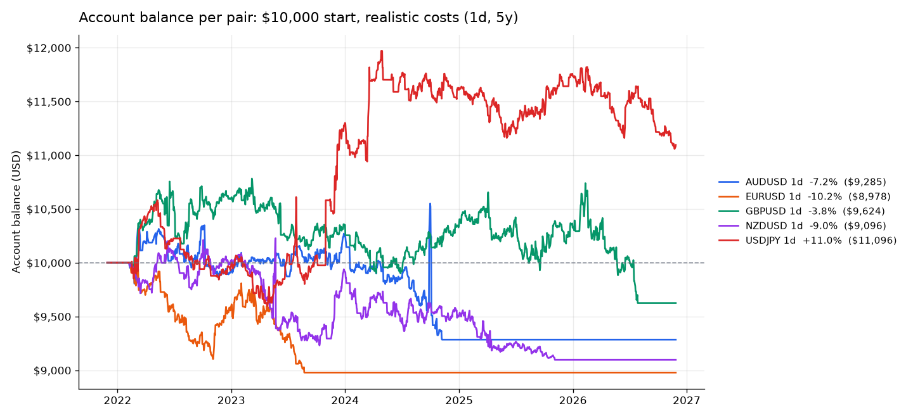

# forex-trading-bot

A disciplined, risk-managed Forex trading bot with market analysis and risk management, built in phases toward backtesting and automated trading.

> **Status:** Phases 1–4 done (data, market analysis, risk management, strategy and backtesting). No broker execution yet. The bot does not place trades. `config/settings.yaml` defaults to paper mode with trading disabled.

## Features

- **Market data** (`src/market/data_fetcher.py`): downloads Forex OHLCV from Yahoo Finance (EURUSD, GBPUSD, USDJPY…), validates it, resamples timeframes (1h → 4h) and saves/loads CSV.
- **Technical indicators** (`src/market/indicators.py`): moving averages, RSI, MACD, Bollinger Bands, ATR and Stochastic.
- **Market analysis** (`src/market/market_analyzer.py`): trend direction (MA order plus slope), RSI and MACD conditions, support/resistance, and confirmed entry signals.
- **Risk management** (`src/risk/`):
  - position sizing by % risk, with take-profit, trailing and break-even stops
  - daily loss, drawdown and consecutive-loss limits
  - win rate, profit factor and expectancy
- **Strategy** (`src/strategy/`): a multi-signal confirmation strategy with a trend filter, ATR stop-loss and risk:reward take-profit. Subclass `Strategy` to add your own.
- **Backtesting** (`src/backtest/`, `run_backtest.py`): bar-by-bar simulation with no look-ahead, plus:
  - spread, slippage and commission
  - your risk limits, applied on historical dates
  - a full report and trade log CSV

## Setup

```bash
git clone https://github.com/nguregitonga/forex-trading-bot.git
cd forex-trading-bot
python -m venv venv
source venv/bin/activate        # Windows: venv\Scripts\activate
pip install -r requirements.txt
```

## Quick example

```python
from src.market.data_fetcher import DataFetcher
from src.market.indicators import TechnicalIndicators
from src.market.market_analyzer import MarketAnalyzer
from src.risk.position_sizer import PositionSizer

data = DataFetcher().fetch_forex_data("EURUSD", interval="1h", period="3mo")
data = TechnicalIndicators.add_all_indicators(data)
print(MarketAnalyzer().get_market_summary(data))

sizer = PositionSizer(account_size=10000, risk_percent=1.0)
print(sizer.calculate_position_size(entry_price=1.0850, stop_loss_price=1.0830))
```

## Backtest

```bash
python run_backtest.py                         # EURUSD, 1h, last 12 months
python run_backtest.py --symbol all --interval 1d --period 5y
```

Plot the saved equity curves with `python plot_equity.py results/`.

### Latest backtest

GitHub Actions re-runs the backtest whenever the strategy, backtester or settings change. You can also run it by hand from **Actions → Backtest → Run workflow**. The full report is in [`reports/backtest_report.txt`](reports/backtest_report.txt).



See [Phase 4: Strategy & Backtesting](PHASE_4_BACKTESTING.md) for the rules, the report and the cost settings.

## Tests

```bash
pytest
```

There are 105 tests. Data-download tests pass offline, because a failed download returns an empty DataFrame. Logs go to `logs/forex_bot.log`. Set `FOREX_BOT_LOG_LEVEL=DEBUG` for more detail.

## Project structure

```
config/settings.yaml      trading, risk, strategy and backtest settings
src/logger.py             shared logging (console + rotating file)
src/market/               data fetching, indicators, market analysis
src/risk/                 position sizing, risk limits, drawdown monitor
src/strategy/             strategy interface and confirmation strategy
src/backtest/             backtest engine, pip maths, performance metrics
run_backtest.py           command-line backtests
tests/                    unit tests
```

Detailed guides: [Phase 2 quick start](QUICK_START_PHASE_2.md), [Phase 2 completion](PHASE_2_COMPLETION.md), [Phase 3 risk management](PHASE_3_RISK_MANAGEMENT.md), [Phase 3 checklist](PHASE_3_CHECKLIST.md), [Phase 4 backtesting](PHASE_4_BACKTESTING.md).

## Roadmap

- [x] Phase 1–2: data and market analysis
- [x] Phase 3: risk management
- [x] Phase 4: strategy and backtesting engine
- [ ] Phase 5: paper trading against a demo broker account
- [ ] Phase 6: notifications (Telegram/email)

## Disclaimer

This project is for education and research only. It is not financial advice. Forex trading carries a high risk of loss. Test only on paper or demo accounts.

## License

MIT. See [LICENSE](LICENSE).
